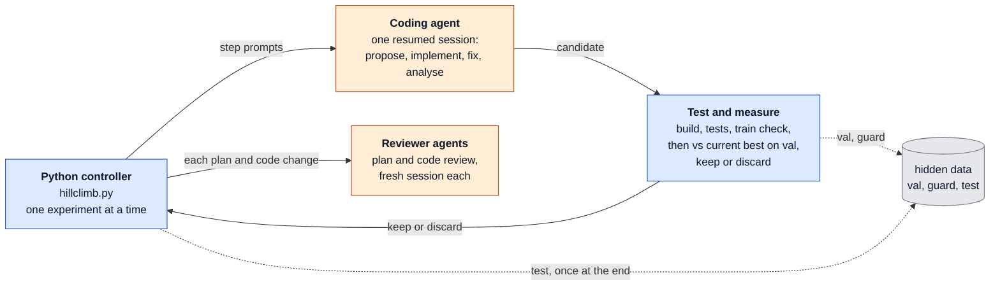
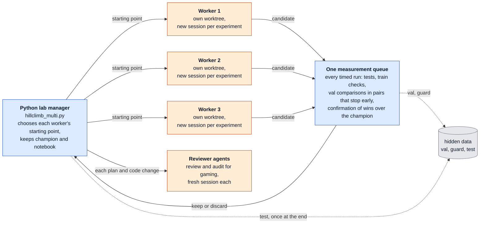
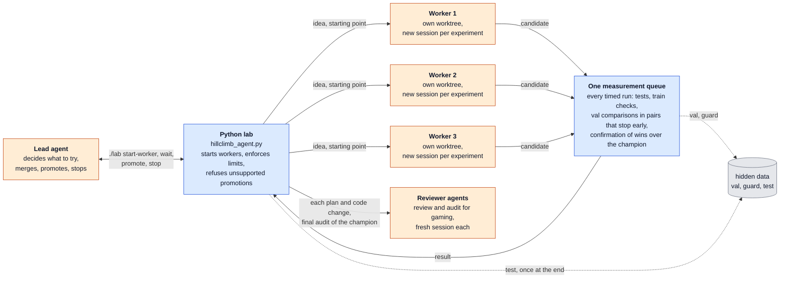
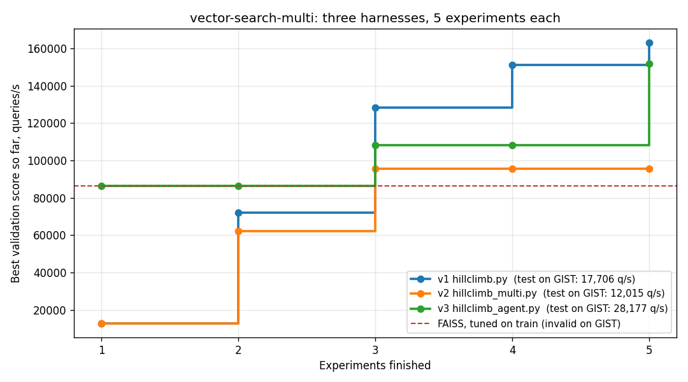
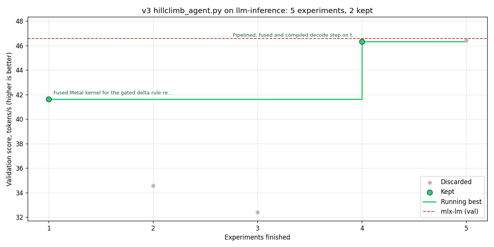

# Hill-climbing harness

A coding agent improves a piece of software in a loop; a controller measures every
candidate on a hidden validation split and decides what is kept. The harness is general:
a task is a folder with a description, starting code, an evaluator and three data splits.

The idea is inspired by Andrej Karpathy's [autoresearch](https://github.com/karpathy/autoresearch).

This is a research prototype. In `hillclimb.py` the agent is kept away from the validation
and test data by instructions and folder layout; `hillclimb_multi.py` and
`hillclimb_agent.py` add Claude Code deny rules and the bash sandbox.

There are three harnesses over the same task folders and the same evaluation code:

| File | Who decides what to try | Agents at once |
|---|---|---|
| `hillclimb.py` | one agent, from the current best | 1 |
| `hillclimb_multi.py` | Python rules (the "lab manager") | 3 workers by default (`--workers N`) |
| `hillclimb_agent.py` | a lead agent, through a `./lab` tool | a lead plus 3 workers by default |

In `hillclimb_multi.py` and `hillclimb_agent.py`, each worker is a separate agent session in
its own git worktree, every speed measurement goes through one queue (never two at once),
a win over the current champion is confirmed with fresh measurements, a code reviewer also
audits for benchmark gaming, and Claude Code sessions get permission deny rules plus the bash
sandbox for the hidden data. Both are needed: tested with `tests/probe_claude.py`, deny rules alone
let a Python script read a hidden file, and the sandbox alone let Claude's Read tool read it.
In v3 the lead decides what to try and what to promote, but Python measures, refuses
promotions the numbers do not support, enforces the limits and runs the test split once.

### How the three harnesses differ

Blue is Python, orange is an agent, grey is hidden data agents may not read: by instruction
in v1; in v2 and v3, enforced for Claude Code sessions with deny rules and the sandbox (other
agent CLIs get instructions only). In every harness, Python measures each candidate on the
hidden validation data and evaluates the final result on the test data once, after the
research ends.

**v1 `hillclimb.py`**: one agent, one experiment at a time. With agents that can resume a
session (Claude Code, Cursor), the agent keeps one session for the whole run; each review is a
fresh session.



**v2 `hillclimb_multi.py`**: three workers run in parallel by default (`--workers N`). Python
gives each one a starting point and tells it what the others are working on; the worker picks
its own idea and area. One queue measures one candidate at a time, so parallel work never
disturbs a benchmark.



**v3 `hillclimb_agent.py`**: a lead agent decides through a `./lab` tool and may run up to three
workers at once by default (`--workers N`), giving each an idea and a starting point. Python
still starts the workers, measures, refuses promotions the numbers do not support, and has the
champion audited by an independent session before the test split.



## Results

Three harnesses on the same task, five experiments each, Claude Opus 5.5 medium for every
agent: build a vector-search engine from scratch in C++ (Apple M3, one thread) and beat a
FAISS reference. Training and validation data are SIFT and Deep vectors; the hidden test is
GIST, a kind of data no run ever measured. Valid only with recall@10 of at least 0.95.

| | v1 `hillclimb.py` | v2 `hillclimb_multi.py` | v3 `hillclimb_agent.py` | FAISS |
|---|---|---|---|---|
| Hours | 0.71 | **0.27** | 0.56 | |
| Agent cost reported | $56 | **$17** | $24 | |
| Best validation, queries/s | **163,057** | 95,453 | 151,824 | 86,390 |
| Test on GIST, queries/s | 17,706 | 12,015 | **28,177** | 16,500-19,300 (per run) |
| Recall@10 on GIST | 0.976 | 0.991 | 0.974 | 0.907, invalid |



All three engines stayed valid on the unseen GIST data, where the train-tuned FAISS setting
did not. v3's lead agent started three different designs in parallel (one was lost to a
usage-limit pause), refined the better one, then merged two later wins, and built the fastest
engine on GIST. v1 had the best validation score; v2 was the fastest and cheapest, but at
five experiments its parallel start is mostly exploration.

Caveats: one run per harness, so an indication, not a measurement; five experiments is a short
budget; in these runs, v2 and v3 workers could not read their own `./dev_eval` results because
of a sandbox bug (fixed since); v3 lost one experiment to a usage-limit pause and was given one
more. Per-experiment tables, plots and the numbers above are in `results/`.

On `llm-inference` (Qwen3.5-0.8B bf16, beat mlx-lm), v3 made the starting engine 1.7x faster
on test (20.5 to 35.6 tokens/s) and matched mlx-lm on validation (46.3 vs 46.6 tokens/s), but
reached 0.92x of mlx-lm on test, where long prompts it never measured were slower.



## Requirements

Python 3.11 or newer, git, and an agent CLI: Cursor's `cursor-agent` (the default for
`hillclimb.py`) or Claude Code `claude` (the default for `hillclimb_multi.py` and
`hillclimb_agent.py`; their data hiding uses Claude Code's permission rules and sandbox).
The harnesses need no Python packages. `uv` is needed for tasks that define an
`[environment]`. The real tasks run on Apple Silicon macOS; each task's `setup.sh` downloads
and rebuilds its data (see the task README).

Set `CURSOR_API_KEY` in `.env` alongside `hillclimb.py` (see `.env.example`), or export it
in your shell. The harness loads `.env` automatically without executing shell code;
existing environment variables take precedence. Single-line values may be quoted;
variable interpolation and multiline values are not supported. Keys are not copied into
run workspaces, and credential values are redacted from agent transcripts.
Interactive `cursor-agent login` is an alternative. `cursor-agent status` reports login
state and may still say not logged in when API-key requests work.

## Use

```sh
python hillclimb.py check tasks/vector-search-multi          # validate the task, measure noise
python hillclimb.py run tasks/vector-search-multi --agent cursor   # run the loop, then the test split
python hillclimb.py status                                  # latest run
python hillclimb.py resume                                  # continue an interrupted run
python hillclimb.py report                                  # print the report again
```

Useful options: `--max-experiments N` and `--max-hours H` on `run` and `resume`;
`--runs-dir DIR` before the command (default `~/.hillclimb/runs`).

There are two tasks, each with a `setup.sh` that downloads and rebuilds its data:

- [`tasks/vector-search-multi`](tasks/vector-search-multi/README.md): build a vector-search
  engine in C++ from an empty interface and beat a hidden, train-tuned FAISS reference.
- [`tasks/llm-inference`](tasks/llm-inference/README.md): make Qwen3.5-0.8B inference in MLX
  faster than mlx-lm.

For scratch starts, final reports compare the first valid implementation with the final
best as well as the reference.

## Parallel and agent-led runs

```sh
python hillclimb_multi.py run tasks/vector-search-multi --agent claude-opus-medium --workers 3
python hillclimb_agent.py run tasks/vector-search-multi --agent claude-opus-medium --workers 3
python hillclimb_multi.py resume [run]          # also: status, report (same for hillclimb_agent.py)
```

Both take `--max-experiments`, `--max-hours` and `--review-agent` (a cheaper agent for
reviews), and `--runs-dir DIR` before the command. `hillclimb_agent.py --lead-agent` picks the
lead's agent. Hitting a usage limit
pauses the run; `resume` continues it. Runs are folders named `<task>-multi-...` and
`<task>-agent-...` with `report.md`, `experiments.jsonl` (one record per experiment),
`notebook.jsonl` (lessons), `journal.jsonl` (timeline of agent calls and measurements) and a
git repository whose `best` branch is the champion.

A task may add `data/guard/`: a different kind of data, checked pass/fail only and never
scored or shown to agents. `hillclimb.py` checks it before keeping a candidate;
`hillclimb_multi.py` and `hillclimb_agent.py` check every valid candidate, since any of them
can become a starting point.

## The loop (`hillclimb.py`)

`hillclimb_multi.py` and `hillclimb_agent.py` run the same steps for each experiment, with these
differences: each worker starts a new session per experiment (in `hillclimb.py` the agent
resumes one session for the whole run); timed steps go through the shared measurement queue,
and val comparisons stop early once the answer is clear; the code review also audits for
benchmark gaming; and an early stop needs approved stop requests from two workers
(`hillclimb_multi.py`) or the lead's decision (`hillclimb_agent.py`).

| # | Step | Done by |
|---|---|---|
| 1 | Propose a hypothesis, write `research/PLAN.md` | Agent |
| 2 | Review the plan: approve, revise or reject | Fresh agent session |
| 3 | Implement | Agent |
| 4 | Review the code | Fresh agent session |
| 5 | Build, test, evaluator on train | Controller |
| 6 | Evaluate on val, alternating with the current best | Controller |
| 7 | Keep or discard by a fixed rule | Controller |
| 8 | Analyze and record the lesson | Agent |

The controller requires non-empty plan sections, valid review verdicts, and a complete
analysis JSON object. Invalid artifacts receive one retry with validation feedback;
repeated contract failures pause without recording the unfinished experiment or using
the test split. Plan approval is required; exhausted revisions do not proceed. Code fixes
receive one further independent review.

If no worthwhile experiment remains, the agent may request convergence in
`research/stop.json`, explaining its evidence and the alternatives considered. A fresh
reviewer must approve before the run stops early. A reviewed stop is recorded as an
experiment outcome with decision `stop`; the budget is a maximum, not a quota.

When the budget is used up or convergence is approved, the controller evaluates the result
on the test split, once. Finalized runs cannot resume further experiments.

## Looking at a run (`hillclimb.py`)

Each run is a folder under `~/.hillclimb/runs/` (runs of the other two harnesses are described
under "Parallel and agent-led runs"):

- `workspace/` is a git repository. `git log best` shows the kept experiments. Every
  experiment has a tag, `exp-0007-keep` or `exp-0007-discard`, so discarded work can still
  be read with `git show`.
- `experiments/0007/` holds that experiment's plan, reviews, diff, test log, val result
  and analysis.
- `experiments.jsonl` has one record per experiment.
- `logs/` has every prompt and the agent's output.
- `report.md` is the summary.

Records are replaced atomically before state is saved. Resume recovers a completed
experiment from the journal if interruption occurred between these writes. Incomplete
experiments restart from the last recorded best. Analysis receives the archived plan of
the actual experiment, including after a discard.

## Writing a task

```
tasks/<name>/
├── task.toml       configuration
├── TASK.md         description the agent reads
├── target/         starting code (a stub, when the agent starts from scratch)
├── reference/      optional: the implementation to beat; the agent never sees it
├── broken/         optional: a wrong candidate the evaluator must reject
├── evaluator/      the evaluation program
├── setup.sh        optional: downloads and rebuilds what git does not hold (data, models)
└── data/train, data/val, data/test, and optionally data/guard
```

`tasks/vector-search-multi/` and `tasks/llm-inference/` are complete examples. The evaluator is
any program that takes a candidate directory and a split directory and writes one JSON file:

```json
{"valid": true, "score": 1834.2, "metrics": {"recall_at_10": 0.96}, "error": null}
```

`valid` is false when the candidate is wrong or breaks a constraint. `score` is the number
that is climbed. `metrics` must be aggregates only, because the agent sees them.

`task.toml` fields, with defaults:

```toml
name = "my-task"
direction = "maximize"                 # or "minimize"

[commands]                             # run inside the candidate directory; {task} = task folder
build = "make"                         # optional
test = "pytest -q"                     # optional, e.g. "python test.py {task}/model"
evaluate = "python {task}/evaluator/evaluate.py --candidate {candidate} --split {split} --out {out}"

[environment]                          # optional: the only packages a candidate may use
python = "3.12"
packages = ["numpy"]
reference_packages = ["faiss-cpu"]     # available to the reference only

[workspace]
editable = ["*"]                       # patterns the agent may edit

[agent]
web_search = true

[eval]
repetitions = 5                        # measurement pairs: current best, candidate
min_improvement = 0.02                 # threshold is max(this, 2 x measured noise)
timeout_s = 600

[budget]
max_experiments = 30
max_hours = 8
max_plan_revisions = 2
max_fix_attempts = 3
agent_step_timeout_s = 1800
```

## Adding an agent

Add an entry to `agents.toml` with its command line. The only requirement is that the
agent can be started with a prompt in a directory and exits when it is done.

## Tests

Each task tests its own scoring rules (no agent, a few seconds):

```sh
uv run --no-project --with numpy==2.2.6 python tasks/vector-search-multi/test_evaluator.py
python3 tasks/llm-inference/test_evaluator.py
```

`tests/probe_claude.py` re-runs the check that Claude Code's deny rules and sandbox hide
files from agent sessions (costs a few cents).

Audit a completed run of any of the three harnesses without changing it: records, tags,
measurements (never two at once), session separation, and for `hillclimb_agent.py` that every
promotion was a confirmed win over the champion of that moment. The run's task folder must still
exist:

```sh
python tests/audit_run.py /path/to/run
```
